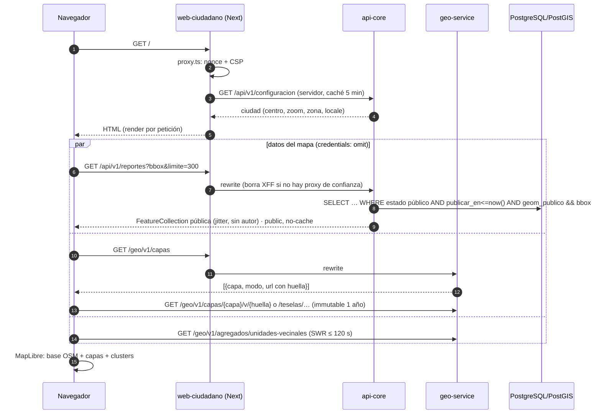
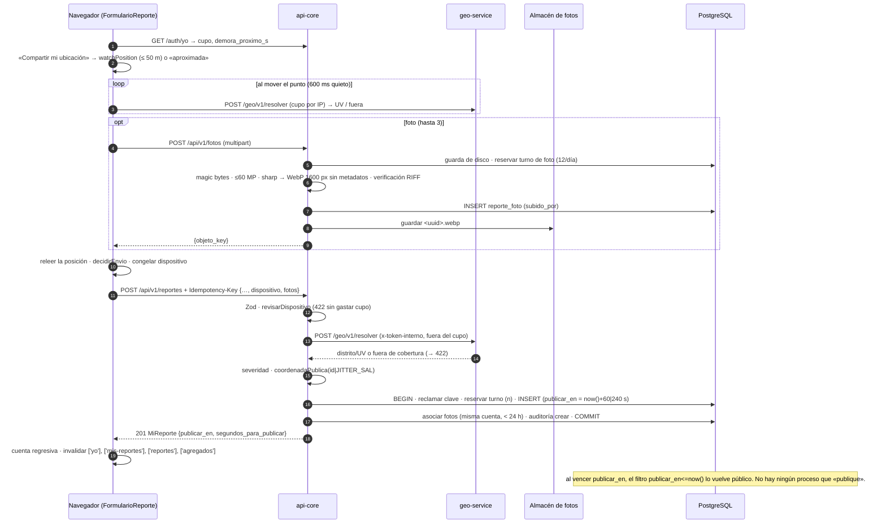
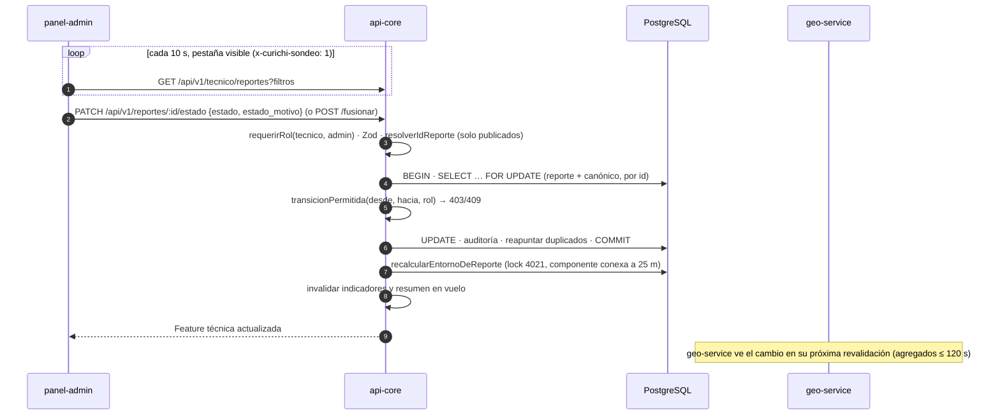

# 10 · Flujos de punta a punta

> Cómo viaja cada acción importante por todas las partes. Diagramas en Mermaid (GitHub los dibuja).
> Leyenda: **[C]** confirmado en código · **[I]** inferido.

## 1. Ver el mapa público (sin cuenta) [C]



## 2. Crear cuenta e iniciar sesión [C]

```mermaid
sequenceDiagram
  autonumber
  participant N as Navegador
  participant A as api-core
  participant DB as PostgreSQL
  N->>A: POST /api/v1/auth/registro {email, nombre, password}
  A->>DB: advisory lock(alta-cuenta:ipHash) · topes hora/día por IP (intento_login)
  A->>A: hash Argon2id (worker) SIEMPRE
  A->>DB: INSERT usuario … ON CONFLICT DO NOTHING (rol = DEFAULT ciudadano)
  A-->>N: 201 CUENTA_LISTA (igual exista o no el correo; sin cookie)
  N->>A: POST /api/v1/auth/login {email|usuario, password}
  A->>DB: freno fuerza bruta (antes de verificar)
  A->>A: verificarPassword (hash señuelo si no existe) · rehash scrypt→argon2
  A->>DB: DELETE sesión previa · INSERT sesion (32 bytes) · auditoría login
  A-->>N: Set-Cookie curichi_sesion (HttpOnly, Lax, Secure según config)
```

## 3. Reportar un punto [C]



## 4. Moderar (técnico o admin) [C]



## 5. Publicación diferida (cómo se «publica» sin un proceso) [C]

```text
t = 0      INSERT … estado='nuevo', publicar_en = now() + 60 s (1.º del día) | + 240 s (2.º y 3.º)
0 < t < 60 solo el AUTOR lo ve (GET /mis-reportes, cualquier estado)
           técnicos: 404 (nadie modera ni exporta antes de publicar_en)
t ≥ 60     GET /reportes (público) lo devuelve: estado ∈ ESTADOS_PUBLICOS AND publicar_en <= now()
           con «NO SE HA VERIFICADO» · aparece en la bandeja técnica
validar    → «Verificado», entra en los puntos críticos y en el color por UV
rechazar/fusionar → sale del mapa; la foto deja de servirse (no-cache + ETag)
```

## 6. Activar una versión nueva de capas [C]

```text
operador:  data/raw/<V>/ + MANIFEST → etl:inspect → etl:run (reporte_calidad) → etl:load (vigente=false)
admin:     panel /capas → POST /api/v1/admin/capas/:id/activar
api-core:  BEGIN · vigente=false (capa) · vigente=true (id) · auditoría · COMMIT → POST /geo/v1/capas/invalidar
geo-svc:   vacía caché → próxima /geo/v1/capas trae una huella nueva → los clientes con la URL vieja reciben 410
           → vuelven a pedir la lista → service worker borra las huellas viejas
reportes:  los anteriores conservan version_capa: sus nombres se leen de SU versión, no de la vigente
```

## 7. Mantenimiento (cada 6 h, una sola réplica) [C]

```text
pg_try_advisory_lock(4023) → (otra réplica lo tiene → saltar)
  rellenar geom_publico pendientes → si hubo, recálculo completo de puntos críticos
  si hay verificados sin punto crítico (desbordes, fallos) → recálculo completo
  ejecutarMantenimiento: sesiones caducadas · ip_hash > 30 d · fotos huérfanas > 24 h (+ borrar objeto)
                         · intentos > 24 h · idempotencia > 24 h · cuotas de días pasados
pg_advisory_unlock(4023)
```

## 8. Dónde se decide cada cosa (resumen)

| Decisión | Dónde |
|---|---|
| ¿Quién es? | api-core `auth.ts` (cookie → `sesion`) |
| ¿Puede hacerlo? | api-core `requerirRol` + `TRANSICIONES` (contracts) |
| ¿Es válido el dato? | Zod de contracts en api-core (el cliente valida solo como UX) |
| ¿Es coherente la ubicación? | api-core `ubicacion-dispositivo.ts` (y el cliente recorta al círculo) |
| ¿En qué distrito y UV cae? | geo-service `resolver.ts` (PostGIS) |
| ¿Qué tan grave es? | contracts `calcularSeveridad` (api-core guarda el resultado) |
| ¿Cuándo se ve y quién lo ve? | api-core `visibilidad.ts` + `publicar_en` en la base |
| ¿Dónde se ve en público? | `geom_publico` (jitter de contracts calculado en api-core) |
| ¿Cuántos puede enviar? | Base: `cuota_reporte_diaria` (+ rate limit por IP en memoria) |
| ¿Qué recurrencia hay? | db `puntos-criticos*.ts` (DBSCAN en PostGIS) |
