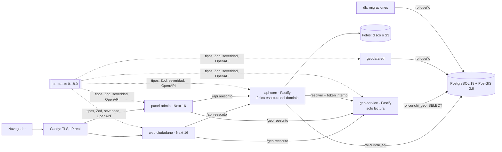

# Evaluación Arquitectónica y de Escalabilidad

> **Informe principal de la FASE 2**, escrito el **2026-10-07**.
>
> **Base**: el código de `main` en el commit `3121a0f`, vuelto a leer para este informe sin dar
> por buenos los documentos anteriores. Incluye mediciones nuevas hechas ese mismo día sobre la
> base aparte `curichi_revision`.
>
> Es **solo análisis**: no se cambió código, dependencias, esquema ni configuración de la
> aplicación. Las recomendaciones están marcadas **[R]** y **no están implementadas**.
>
> Complementa (y en lo que difiera, **corrige**) a [11 · Escalado y ecosistema](11-escalado-y-ecosistema.md).

**Leyenda**

| Marca | Significa |
|---|---|
| **MEDIDO** | Ejecutado el 2026-10-07 en esta máquina; las condiciones están en §22 |
| **MEDIDO (F4)** | Medido en la Fase 4 (2026-09-15), según `docs/TRASPASO.md` y [11](11-escalado-y-ecosistema.md). No se volvió a medir |
| **ESTIMADO** | Deducido de lo medido con supuestos explícitos |
| **DESCONOCIDO** | No hay medición que lo respalde |
| **[C]** | Confirmado leyendo el código |
| **[I]** | Inferido |
| **[R]** | Recomendación, no implementada |

---

## 1. Resumen ejecutivo

1. **Versión.** La versión correcta y completa es `main` = `origin/main` = **`3121a0f`** (2026-10-04
   22:16). Contiene todo el trabajo del equipo del 3 y 4 de octubre: 23 commits, el PR #1 y el
   contenido de las tres ramas de trabajo. Lo único posterior en el remoto son PRs de Dependabot
   (#13–#17) **sin fusionar**. No había trabajo local en riesgo.
2. **Arquitectura.** Es un **monolito modular distribuido en dos servicios**:
   - `api-core` escribe;
   - `geo-service` solo lee;
   - dos apps Next.js;
   - un paquete de contratos que manda sobre todos;
   - PostgreSQL + PostGIS como autoridad única de estado.

   Está bien hecha:
   - reglas en la base;
   - mínimo privilegio;
   - visibilidad en un solo lugar;
   - contratos tipados;
   - pruebas.
3. **Acoplamiento.** Hay un **núcleo de plataforma reutilizable** casi sin tocar:
   - ETL;
   - `geo-service`;
   - autenticación, sesiones y auditoría;
   - fotos;
   - publicación diferida;
   - infra.

   El **dominio de inundación** está mezclado en cuatro lugares:
   - la tabla `reporte_inundacion` y sus `ENUM` de PostgreSQL;
   - los esquemas y la severidad de `contracts`;
   - el formulario ciudadano;
   - casi todo el panel (indicadores y ejecutivo giran en torno a la severidad).

   **No existe** el concepto de «categoría» o «tipo de reporte» en ninguna capa [C].
4. **Escalabilidad.** El cuello de botella **no es fijo**: depende del volumen y de cuánta CPU
   tenga la base.
   - **Con la base escasa de CPU** (2 CPU, 1 M de reportes) **manda PostgreSQL**: 21 rps
     **MEDIDO (F4)**.
   - **Con 100 000 reportes y la base con 4 CPU**, PostgreSQL atiende **300–360 consultas de mapa
     por segundo** desde dentro del contenedor **MEDIDO**.
   - En ese escenario, lo primero que se satura es **un proceso de `api-core`**: ~70–80 rps, por
     serializar y comprimir ~224 KB por respuesta del mapa **MEDIDO**. Hay que tomarlo con cautela:
     el servicio corría en modo desarrollo.
   - Otros límites duros:
     - el **login con Argon2id**: 12–17 por segundo y por instancia **MEDIDO**;
     - el **agregado por UV**: 184 ms a 100 000 reportes, crece en forma lineal y ordena en disco
       **MEDIDO**.
5. **Escala de usuarios.**
   - Hasta **~1 000 usuarios concurrentes** entra en una VPS con la arquitectura actual
     **ESTIMADO**.
   - **10 000** exige cambios: caché del listado público, respuestas más livianas y más CPU o
     réplicas de lectura **ESTIMADO**.
   - **100 000** está fuera de lo que esta arquitectura puede respaldar sin rediseñar el camino de
     lectura **DESCONOCIDO**.
6. **Recomendación [R].** **Estrategia D**: monolito modular primero, separación después solo
   con métricas. Se implementa como **núcleo de plataforma + módulos por categoría** dentro del
   mismo monorepo y del mismo despliegue por ciudad.
   - Microservicios **no**: el cuello medido es la base y el tamaño de las respuestas, no los
     límites entre servicios.
   - Antes de crear la primera categoría hay que decidir, con un ADR y una prueba, el **modelo de
     datos del reporte genérico**.

---

## 2. Versión exacta analizada

| Dato | Valor |
|---|---|
| Repositorio | `github.com/paltaunkwnow/MICURICHI` (`origin`) |
| Rama | `main` (local = remota) |
| Commit | **`3121a0ff9d496fde84a888f4f9131080966bde63`** |
| Fecha | 2026-10-04 22:16:09 -0400 |
| Mensaje | `feat(repo): reportar con ubicación aproximada desde dispositivos sin GPS (ADR 0007)` |
| Commits en `main` | 87 |
| `packages/contracts` | **0.18.0** |
| Última migración | **0019** (`ubicacion_aproximada`) |
| Capas cargadas en `curichi_revision` | `DM_UV_MZ_2025`: 16 distritos, 576 UV, 27 527 manzanas |

**Por qué esta versión** [C]:

- `git fetch --prune` del 2026-10-07 no trae commits nuevos en `main`.
- `main` local y `origin/main` apuntan al mismo hash.
- Las tres ramas de trabajo del equipo están contenidas en `main` (§4).
- El PR #1 está fusionado.
- Los únicos cambios remotos posteriores son PRs de bots sin fusionar. Las versiones mayores que
  traen exigen un ADR según CLAUDE.md §8.1.

---

## 3. Historial de cambios de los últimos días

Todo lo del 3 y 4 de octubre lo subió `paltaunkwnow`. En el remoto quedó **lineal**, sin commits de
fusión: el PR #1 se integró por rebase [I, por la ausencia de merge commits].

### 2026-10-03 (13:25–13:28): cierre del PR #1 y arreglos

| Commit | Parte | Qué cambió |
|---|---|---|
| `62d9a06` | contracts | Frecuencia `agua_estancada`; login con usuario sin dominio |
| `4ecf731` | db | Migración **0017** `agua_estancada`; cuentas de desarrollo con contraseña corta |
| `2f9b2c1` | api-core | Fusión con ID corto, mensajes de moderación, login sin atajos (ver deuda §30.2) |
| `f9e3e3d` | web-ciudadano | Aviso de punto resuelto, frecuencia nueva, acceso con usuario |
| `b2786d4` | panel-admin | Mapa en la pantalla ejecutiva, ficha unitaria, bandeja clicable |
| `39b4956` | repo | `next` 16.3.6 y `brace-expansion` ^5.0.11 por avisos de seguridad |
| `90eb0bc` | e2e | Runner local con base aparte `curichi_e2e` |
| `b8d4903` | repo | Lanzador único `Mi-Curichi.exe` |
| `cc17523` | repo | `/sdd` mide la línea base antes de tocar código |
| `450e40e`, `a8095b1` | docs | Pantalla ejecutiva; mapeo y pruebas del 2026-10-03 |

### 2026-10-04 (11:09–22:16): indicadores, análisis y ubicación aproximada

| Commit | Parte | Qué cambió |
|---|---|---|
| `34ef38b` | contracts | **0.16.0**: filtros de severidad y distrito en `/indicadores` |
| `0827f32` | api-core | `/indicadores` acepta `severidad` y `distrito_id` |
| `2b7380e`, `20f15e9`, `d46aaed` | panel-admin | Mapa de la bandeja reactivo; «Capas» solo admin; tortas por distrito y UV |
| `2bf512b` | e2e | Pruebas de tortas, mapa reactivo y Capas |
| `e2cd83f` | docs | Relevamiento de plataformas de riesgo. Fecha de autor 09-18: es el **cherry-pick** de la rama de investigación |
| `5560fc8`, `888bce8` | claude | Manual al día y correcciones |
| `7369132` | repo | Arreglos del análisis, pestañas de severidad, fusión con cercanos (0.17.0) |
| `9ef7729` | claude | Plan con el modelo más potente y subagentes por nivel (§12.4) |
| **`3121a0f`** | repo | **Ubicación aproximada** (ADR 0007, migración 0019, contracts 0.18.0) |

---

## 4. Branches y PRs relevantes

### 4.1 Ramas remotas

| Rama | Último commit | Relación con `main` |
|---|---|---|
| `main` | `3121a0f` (10-04) | Es la versión usada |
| `feat/repo/produccion-vps` | `888bce8` (10-04) | **Ancestro** de `main`: ya integrada |
| `feat/repo/cuentas-ciudadanas-y-auditoria` | `a06d281` (09-25) | **Ancestro** de `main` (PR #1) |
| `claude/disaster-alert-platforms-research-c6sjk5` | `8a8c843` (09-18) | No es ancestro, pero `git cherry` da **0 commits pendientes**: su parche es `e2cd83f` |
| `dependabot/*` (5 ramas) | 10-05 | PRs #13–#17 abiertos, sin fusionar |

### 4.2 Pull requests

| PR | Estado | Qué es | Decisión |
|---|---|---|---|
| **#1** | **Fusionado el 2026-10-03** | `[P1–P5]` Cuentas ciudadanas, cupo y auditoría | Incluido en `3121a0f` |
| #2–#12 | Cerrados sin fusionar (10-03/04) | Dependabot: majors de TypeScript 7, Vitest 5, actions, etc. | Fuera: el equipo los rechazó |
| #13–#17 | Abiertos (10-05) | Dependabot: `geojson-vt` 5, 19 menores, 3 actions | **No se usan**: son de un bot, posteriores, y los majors exigen ADR (§8.1) |

---

## 5. Estado de sincronización

| Archivo o grupo | Versión en disco | Decisión |
|---|---|---|
| Todo lo versionado | = `3121a0f` | Correcta; nada que fusionar |
| `apps/*/next-env.d.ts` (2) | Modificados | Los reescribió `next dev` (la ruta `.next/types` pasó a `.next/dev/types`) al levantar el proyecto el 2026-10-06. **No es trabajo del equipo**; se dejan como están. Se restauran con `git checkout -- apps/web-ciudadano/next-env.d.ts apps/panel-admin/next-env.d.ts` |
| `PROJECT_STRUCTURE_AND_FUNCTIONALITY.md`, `docs/arquitectura/` | Sin seguimiento | Documentación de estas fases, sin commitear |
| `ContextosySkills/`, `.claude/settings.local.json` | Sin seguimiento | Sistema de continuidad de contexto de Claude Code (ver `ContextosySkills/README.md`); no es parte de la aplicación |

Lo que **no** se hizo:

- No hubo `git pull` a ciegas.
- No se sobrescribió nada local.
- No hubo commits, push ni PR.
- La base del usuario (`curichi`) no se tocó.

Todo se midió en `curichi_revision`, que quedó como estaba: 37 reportes y 22 puntos críticos.

---

## 6. Arquitectura actual



### Principios que sostienen el diseño [C]

1. **La base es la autoridad.** En tablas viven:
   - sesiones;
   - cupos diarios (`cuota_reporte_diaria`);
   - idempotencia;
   - freno de login (`intento_login`);
   - publicación diferida (`publicar_en <= now()`).

   Por eso el estado **no** está en la memoria de los procesos, con dos excepciones: el rate limit
   por IP y las cachés.
2. **El contrato manda.** Valores, reglas y mensajes salen de `packages/contracts`. Un cambio
   rompe la compilación del consumidor, no la producción.
3. **Una sola condición de visibilidad.** `condicionPublico` y `condicionPublicado` se aplican en
   todas las rutas.
4. **Mínimo privilegio.** Hay tres roles de PostgreSQL con privilegios por tabla y por columna, y
   `geo-service` no puede escribir.
5. **Público y técnico son rutas distintas.**
   - Lo público usa `geom_publico` con jitter determinista y no mira la sesión.
   - Lo técnico usa `geom` exacta.
6. **Coordinación entre réplicas por la base**, con *advisory locks*:
   - 4021: puntos críticos;
   - 4022: migraciones;
   - 4023: mantenimiento.

### Cómo se ve el tráfico [C]

- **Lecturas.** Dominan:
  - mapa público (sin refresco automático);
  - capas y teselas con huella e `immutable`;
  - panel con sondeo cada 10 s por pestaña visible.
- **Escrituras.** Están **acotadas por diseño**: 3 reportes y 12 fotos por cuenta y por día, más el
  límite por IP.
- **Login.** Es caro a propósito: Argon2id (19 MiB, t = 2) en 2 *worker threads* por proceso.

---

## 7. Estructura actual

| Carpeta | Parte | Archivos fuente* | Qué es |
|---|---|---|---|
| `packages/contracts/src` | Transversal | 14 | Enums, Zod, severidad v2, `CONFIG_DOMINIO`, OpenAPI generado |
| `packages/db/src` + `migraciones` | 4 | 27 + 19 | Esquema espejo en Drizzle; consultas en SQL con `pg`; DBSCAN; roles; seeds |
| `services/api-core/src` | 3 | 28 | Reportes, moderación, auth, fotos, exportación, indicadores, mantenimiento |
| `services/geo-service/src` | 4 | 11 | PIP, capas con huella, teselas MVT al vuelo, agregados, puntos críticos |
| `apps/web-ciudadano/src` | 1 | 112 | Mapa público, detalle, formulario con GPS y cámara, «Mis reportes», PWA |
| `apps/panel-admin/src` | 2 | 109 | Bandeja, moderación, indicadores, ejecutivo, capas, plano |
| `pipelines/geodata-etl/src` | 5 | 11 | Shapefile → GeoJSON → PostGIS (mapshaper + turf) |
| `infra/`, `e2e/`, `.github/`, `scripts/` | 5 | 21 / 33 / — / — | Compose, Caddy, SQL de roles, CI, E2E, benchmarks, lanzador |

\* Archivos `.ts/.tsx/.mjs/.sql/.yml` contados el 2026-10-07, sin `node_modules`, `dist` ni `.next`.

---

## 8. Dependencias

| Capa | Versión fijada [C, `package.json`] | Nota |
|---|---|---|
| Node / pnpm / Turborepo | 24.x / 12.4.1 / 2.10.12 | |
| TypeScript | 5.9.3 | Fijada; el major 7 fue rechazado (PR #8) |
| Next / React | 16.3.6 / 19.3.0 | 16.3.6 por aviso de seguridad (10-03) |
| MapLibre / TanStack Query / RHF / Zod | 6.9.0 / 5.102.8 / 7.88.0 / 4.6.4 | |
| Fastify / `@fastify/compress` / `@fastify/rate-limit` | 5.12.4 / ^9.2.0 / 11.2.0 | El rate limit vive en memoria |
| `pg` / Drizzle | 8.23.0 / 0.45.2 | Drizzle solo como espejo del esquema |
| `sharp` | 0.35.4 | WebP sin metadatos |
| `geojson-vt` / `vt-pbf` | 4.0.3 / 3.1.3 | El PR #17 propone `geojson-vt` 5, sin fusionar |
| `hash-wasm` | 4.12.0 | Argon2id sin dependencias nativas |
| mapshaper / turf | 0.7.61 / 7.4.0 | ETL sin GDAL (ADR 0002) |
| Vitest / PGlite | 4.1.11 / 0.5.8 | Bases efímeras en las pruebas |
| PostgreSQL + PostGIS | `postgis/postgis:18-3.6` | Igual en local y en producción |

### Riesgo de dependencias

- **No hay dependencias propietarias.** El mapa base OSM es solo para desarrollo (§14.3 del
  manual).
- Lo que **ata la evolución**:
  - Next 16 App Router;
  - los `ENUM` de PostgreSQL;
  - `geojson-vt` 4 (teselas al vuelo en memoria).

---

## 9. Acoplamiento al dominio de inundaciones

Apariciones de términos del dominio en el código actual. El formato es *apariciones / archivos*;
«—» significa ninguna [C, conteo del 2026-10-07].

| Paquete | `inundaci…` | `reporte_inundacion` | `profundidad` | `frecuencia` | `sumidero` | `severidad` | `curichi` |
|---|---|---|---|---|---|---|---|
| contracts | 9/4 | — | 28/4 | 20/3 | 41/3 | 93/8 | 7/5 |
| db/src | 26/9 | 23/9 | 12/3 | 12/3 | 21/2 | 42/4 | 36/12 |
| db/migraciones | 75/14 | 75/14 | 7/1 | 9/3 | 35/2 | 42/6 | 46/8 |
| api-core | 24/12 | 21/11 | 8/3 | 8/3 | 23/3 | 96/7 | 50/12 |
| geo-service | 4/2 | 4/2 | — | — | — | 13/2 | 29/5 |
| web-ciudadano | 6/6 | — | 79/14 | 47/10 | 182/5 | 192/17 | 34/20 |
| panel-admin | 62/13 | — | 99/14 | 79/13 | 53/6 | **673/42** | 36/12 |
| geodata-etl | — | — | — | — | — | — | — |
| infra | 3/1 | 3/1 | — | — | — | 1/1 | 82/12 |
| e2e | 9/2 | — | 33/7 | 32/7 | 29/5 | 56/12 | 60/11 |

### Lectura

1. **Acoplamiento estructural** (caro de mover):
   - el nombre de la tabla `reporte_inundacion`, en 75 lugares de 14 migraciones y en el código de
     `db`, `api-core` y `geo-service`;
   - los `ENUM` de PostgreSQL del dominio:
     - `profundidad_estimada` (antes `tirante_estimado`);
     - `frecuencia`;
     - `causa_presunta`;
     - `sumidero_cercano` y `sumidero_estado`, con versiones `_v2`;
     - `severidad`.

   Sumar un valor a un `ENUM` exige una migración; quitarlo, rehacer el tipo. Ya pasó con los
   `_v2`.
2. **Acoplamiento conceptual** (la severidad):
   - es una función pura de profundidad × frecuencia (`contracts`);
   - el panel la usa en **673 lugares de 42 archivos**: pestañas, tortas, filtros, ejecutivo;
   - es el eje del producto.
3. **Acoplamiento de marca** (barato):
   - `curichi` en cookies (`curichi_sesion`);
   - dominio de cuentas `@curichi.local`;
   - roles `curichi_api` y `curichi_geo`;
   - nombres de contenedores (82 apariciones en `infra`).

   Se cambia con un renombre parametrizado.
4. **Sin acoplamiento**:
   - `geodata-etl` (0 términos);
   - el núcleo de `geo-service`: solo `visibilidad.ts` y `servidor.ts` mencionan la tabla de
     reportes;
   - autenticación;
   - fotos;
   - auditoría.

**No existe** «categoría», «tipo de reporte» ni «temática» en ningún paquete [C]. Las 7 apariciones
de «categoría» en el panel son la palabra de una tabla de gráfico y un texto de ordenanza.

---

## 10. Reutilización del sistema

Clasificación pedida, sobre el código actual:

| Componente | Clasificación | Por qué |
|---|---|---|
| `pipelines/geodata-etl` | **Reutilizable directamente** | Parametrizado por `config/capas.yaml`; 0 términos del dominio |
| `geo-service`: PIP, capas con huella, teselas MVT, caché | **Reutilizable directamente** | Opera sobre `geo.*`; las reglas de borde, hueco y cobertura son genéricas |
| Autenticación, sesiones, roles, freno de login, Argon2id (`db/password.ts`) | **Reutilizable directamente** | Sin dominio. Los roles son de producto, no de categoría |
| Fotos: magic bytes, WebP sin EXIF, guarda de disco, S3 | **Reutilizable directamente** | Sin dominio |
| Auditoría, idempotencia, cupos, mantenimiento, advisory locks | **Reutilizable directamente** | Tablas genéricas |
| Infra: Compose, Caddy, CI, respaldos, observabilidad, lanzador | **Reutilizable con cambios menores** | Renombrar `curichi` (82 apariciones) y parametrizar nombres |
| Configuración por ciudad (`CIUDAD_*`, ADR 0004) | **Reutilizable directamente** | Ya es por instalación |
| Publicación diferida y visibilidad (`condicionPublico`) | **Reutilizable con cambios menores** | Lógica genérica escrita contra `reporte_inundacion` |
| Máquina de estados y moderación (validar, rechazar, fusionar, retirar) | **Reutilizable con cambios menores** | `TRANSICIONES` es genérica; la fusión y el motivo también |
| Ubicación del dispositivo (radio 60 m, ADR 0007), jitter | **Reutilizable directamente** | Contratos `geo.ts` genéricos |
| Puntos críticos (DBSCAN) | **Necesita abstracción** | Algoritmo genérico, pero el radio, la tabla y «verificados» son de inundación |
| `contracts` | **Necesita abstracción** | Mezcla esquemas genéricos (geo, auth, admin) con los de inundación (`reporte.ts`, `severidad.ts`, `enums.ts`) |
| Modelo `reporte_inundacion` y sus `ENUM` | **Necesita abstracción** | Columnas del dominio en la tabla central |
| `api-core`: exportación, indicadores, ejecutivo | **Necesita abstracción** | Columnas del CSV, cortes por severidad y nota metodológica de inundación |
| Mapa público y clustering (web) | **Reutilizable con cambios menores** | MapLibre genérico; leyenda y pastillas por severidad |
| `FormularioReporte` (web) | **Específico de inundaciones** | Profundidad por referencia corporal, frecuencia, sumidero, causa |
| Severidad v2 (`calcularSeveridad`) | **Específico de inundaciones** | 2·P + F |
| Indicadores, ejecutivo, plano (panel) | **Específico de inundaciones** | Construidos alrededor de severidad y frecuencia |
| `docs/dominio/drenaje-y-pavimento.md`, nota metodológica §9.4 | **Específico de inundaciones** | Parte del pavimento sirve para baches |

---

## 11. Preparación para múltiples categorías

| Categoría | Encaje con lo actual | Qué falta |
|---|---|---|
| **Inundaciones** | **100 %**: es el producto | Cerrar la deuda de §30 |
| **Baches** | **Alto en lo genérico**: punto + foto + estado + PIP + recurrencia. Ya hay `hundimiento_pavimento` como causa y vocabulario de pavimento (PCI, IRI) | Campos propios (tamaño, profundidad, carril), severidad propia, radio de recurrencia menor (5–10 m, a validar), «resuelto» atado a una obra |
| **Basura** | **Alto**: punto + foto + recurrencia (microbasurales) | Campos propios (volumen, tipo de residuo), severidad por volumen o riesgo, quizá ciclo más corto (retiro en días) |
| **Áreas verdes** | **Medio-bajo** | Muchas incidencias son sobre un **área o un árbol** (parque, plaza) y no sobre un punto. Faltan capas de parques (el ETL sirve tal cual) y, si se quiere polígono, **generalizar la geometría** (hoy `Point` en todo el camino: contrato, tabla, jitter, DBSCAN, radio del dispositivo) |
| **Futuras** | **Alto si son puntuales**; **bajo si son lineales o de área** (vereda en tramo, alumbrado de una cuadra) | La geometría `Point` es la frontera real del modelo |

### Lo que hoy **impide** una segunda categoría sin tocar código [C]

1. No hay columna ni contrato de **categoría**.
2. La tabla y los `ENUM` son de inundación.
3. La severidad es una función única.
4. El formulario y el panel están cableados a esos campos.
5. Las exportaciones y la nota metodológica son de inundación.

---

## 12. Evaluación del modelo de datos

### Fortalezas [C]

- **Geometría y PIP**:
  - `geom` y `geom_publico` en EPSG:4326 con GIST;
  - PIP en PostGIS con índice (nunca en memoria).
- **Capas versionadas**: `geo.<capa>` con PK `(id, version_capa)`, `capa_version` y vistas
  `*_vigente`. Activar una versión no rompe los reportes viejos, porque guardan `version_capa`.
- **Estado de negocio en tablas**: cupos, idempotencia, sesiones, freno de login, auditoría con
  antes y después.
- **Visibilidad como filtro**: `publicar_en`, con un `CHECK` entre `creado_en` y `+1 h`.
- **Mínimo privilegio por tabla**: `curichi_api` tiene `SELECT, INSERT, UPDATE` sobre `reporte_inundacion` (migración 0008) y privilegios **por columna** solo en `usuario` (0009, 0016). `curichi_geo` solo tiene `SELECT`.
  *Corregido el 2026-10-07 (FASE 3): la primera versión decía «privilegios por columna» para `curichi_api` en general; en la tabla de reportes son por tabla.*

### Debilidades para escalar o para varias categorías

| Tema | Hallazgo | Efecto |
|---|---|---|
| Tabla central de dominio | `reporte_inundacion` mezcla núcleo (ubicación, estado, publicación, autor) y dominio (profundidad, frecuencia, sumidero, causa) | Una categoría nueva no tiene dónde vivir |
| `ENUM` de PostgreSQL | Siete tipos de dominio; dos ya tuvieron que rehacerse (`_v2`) | Evolucionar valores exige migraciones con bloqueo |
| Sin FK a `geo.*` | `distrito_id` y `unidad_vecinal_id` se guardan con `version_capa` y sin FK [C] | Correcto para versionar capas; la integridad la da el PIP y no la base |
| Severidad guardada | `severidad_calculada`, `severidad_puntaje`, `severidad_version` | Bien versionada, pero solo una función |
| Agregado por UV | Agrupa **todas** las filas por UV y punto crítico en cada cálculo | Lineal con el volumen; a 100 000 ya ordena en disco (§17) |
| `punto_critico` | Un solo espacio de agrupación | Con categorías, los grupos tendrían que separarse por categoría |

### Patrones posibles para el reporte genérico [R, para un ADR; no implementar todavía]

| Patrón | Idea | A favor | En contra |
|---|---|---|---|
| **P1: núcleo + detalle JSONB** | `reporte` (núcleo) + `categoria` + `detalle jsonb`, validado por Zod de cada categoría en `contracts` | Una tabla, un índice espacial, una visibilidad; categorías nuevas sin migración | Validación en la app; índices sobre JSONB para filtrar; reportes de BI menos directos |
| **P2: núcleo + tabla por categoría** | `reporte` 1:1 con `reporte_inundacion`, `reporte_bache`… | Tipos fuertes en la base; cada categoría con sus `CHECK` | Una migración y un JOIN por categoría; más código por categoría |
| **P3: tabla por categoría completa** | Copiar la tabla actual por categoría | Rápido | Duplica visibilidad, moderación y DBSCAN; deriva |

La opción con menos riesgo para este código parece **P2** (o P1 si las categorías van a ser
muchas y cambiantes) **[I]**. Se decide con un *spike* medido, no ahora.

---

## 13. Evaluación de la API

### Fortalezas [C]

- Prefijo `/api/v1` y OpenAPI generado desde Zod: el CI comprueba que no cambie al regenerarlo.
- Validación Zod en el servidor; autorización por rol en cada *handler*; errores con código
  estable (`422 FUERA_DE_COBERTURA`, `429 CUOTA_DE_REPORTES`, …).
- Separación pública y técnica, idempotencia por cuenta, compresión `@fastify/compress`
  (224 KB → 14,5 KB **MEDIDO**).

### Debilidades [C]

| Tema | Hallazgo |
|---|---|
| Respuestas grandes | El listado del mapa con 300 puntos pesa **224 KB** sin comprimir (~750 B por punto) y se comprime **en cada petición**. Es el costo dominante de `api-core` (§19) |
| Conteo por petición | Cada listado hace `count(*)` con tope de 10 001 filas, más la página. Hasta 10 001 filas leídas solo para el total |
| Caché del listado público | `public, no-cache`: el navegador siempre revalida; no sirve para un CDN tal como está |
| Rutas de dominio | `/indicadores`, `/ejecutivo/resumen` y `/exportar` están construidas sobre severidad y estado de inundación |
| Coherencia contrato ↔ manual | `PATCH /reportes/:id/estado` acepta **solo UUID** en `fusionado_en_id` (`z.uuid()`, `contracts/src/esquemas/reporte.ts:331`). El commit `2f9b2c1` y CLAUDE.md §7.3 dicen «UUID o ID corto». El ID corto solo lo acepta `POST /fusionar` |

### Multi-categoría [R]

- Las rutas genéricas (`/reportes`, moderación, fotos, auth, `/configuracion`) pueden quedar.
- El filtro y el cuerpo ganarían `categoria`, y el detalle se validaría por categoría.
- `/indicadores` y `/ejecutivo` necesitan un modelo de «indicador por categoría».

---

## 14. Evaluación del frontend

| Aspecto | `web-ciudadano` | `panel-admin` |
|---|---|---|
| Reutilizable | Mapa MapLibre, clustering, capas con huella, PWA, sesión, cámara en página, GPS con radio | Bandeja (tabla + mapa sincronizados), filtros por zona, moderación, sondeo de 10 s, capas |
| Específico | `FormularioReporte.tsx` (más de 1 000 líneas), pastillas y leyenda por severidad, textos de limitaciones de inundación | Indicadores (tortas y pestañas por severidad), ejecutivo, plano (ordenanza de curichis) |
| Deuda vista [C] | `alSimular` siempre activo (D2, `FormularioReporte.tsx:1027`); `onKeyDown` global de Enter (`:948`); listas de enums repetidas (`:124-140`) | `obtenerReportesPublicos` tipado como colección técnica y `obtenerYo` como `Usuario` (`lib/api.ts:224`) |
| Escala | Sin tráfico automático (bien). Pide hasta 300 puntos por movimiento del mapa | Cada pestaña visible del panel: una petición por pantalla cada 10 s |

Para varias categorías, el patrón natural es un **registro de categorías en el cliente**
(formulario, leyenda, filtros y textos por categoría) sobre el mapa y la bandeja comunes [R].

---

## 15. Evaluación geoespacial

| Pieza | Estado | Medido |
|---|---|---|
| PIP (`POST /geo/v1/resolver`) | GIST, reglas de borde, hueco a 20 m y fuera de cobertura | p95 27 ms con 10 concurrentes, ~510–546 rps por HTTP **MEDIDO**; 17,7 ms **MEDIDO (F4)** |
| Capas con huella | `immutable` 1 año; 410 con huella vieja | UV: GeoJSON de 387 KB; distritos: 35 KB; manzanas por teselas (15,9 MB en web) [C] |
| Teselas MVT al vuelo | `geojson-vt` en memoria por réplica | z15 del centro: 11,7 KB, ~500 rps **MEDIDO** |
| Agregados por UV | Caché SWR de 120 s por réplica | 135 KB por respuesta; ~300 rps desde caché **MEDIDO**; cálculo en frío 184 ms a 100 000 reportes **MEDIDO** |
| DBSCAN (puntos críticos) | eps = 25 m en EPSG:32720 | `SELECT` completo con 75 030 verificados uniformes: **678 ms**, 55 988 grupos, el mayor de 216 **MEDIDO**. Con 750 000 densos, un grupo de 750 021 y 41,9 s **MEDIDO (F4)** |
| ETL | Sin dominio; mapshaper + turf | 27 527 manzanas cargadas y 27 434 en la capa web [C]. La diferencia probablemente sean duplicadas o vacías excluidas [I] |

### Conclusión

Lo geoespacial **no es** el cuello a la escala actual. Los dos riesgos reales son:

- el **encadenamiento de DBSCAN** con datos densos;
- el **agregado por UV**, que crece en forma lineal.

---

## 16. Evaluación de infraestructura

| Tema | Estado [C] |
|---|---|
| Topología | Una VPS por ciudad (ADR 0006); Compose con perfiles `servicios`, `minio`, `respaldos`, `observabilidad` |
| Límites del Compose | postgis **4 CPU / 1,5 GiB**; api-core 2 / 768 MB; geo-service 2 / 1 GB; apps 1 / 512 MB; Caddy 1 / 256 MB. Con observabilidad suman ≈ 15,75 CPU y 7,2 GB de límite (máximo, no reserva) |
| PostgreSQL | `max_connections=100`, `shared_buffers=256MB`, `work_mem=8MB`, `maintenance_work_mem=128MB` |
| Proxy | Caddy reemplaza `X-Forwarded-For`; `TRUST_PROXY=1` en api-core (el comentario de `geo-service/src/proxy.ts:17` dice «2»: ver §30) |
| Réplicas | Caddy reparte por DNS (`dynamic a`, `round_robin`); Prometheus las descubre |
| CI | gitleaks, verificar, e2e, postgres-real, imágenes + Trivy, infra, publicar; Dependabot con 7 días de espera |
| Faltantes para escalar | Sin PgBouncer; sin réplicas de lectura; sin CDN delante del listado público; rate limit por IP en memoria |

---

## 17. Evaluación de PostgreSQL

| Punto | Hallazgo |
|---|---|
| Consultas del mapa a 100 000 reportes | Conteo 1,0–3,7 ms y página 0,4–3,8 ms **MEDIDO** (`EXPLAIN ANALYZE`). Usa `reporte_geom_publico_gist` o `reporte_creado` con *incremental sort* |
| Planificación | La primera planificación del conteo con bbox costó 12 ms (luego 1,6 ms). `pg` usa sentencias sin nombre: se replanifica cada vez [I] |
| Techo de la consulta del mapa | **300–360 pares de consulta por segundo** (conteo + página de 300) con 8–24 clientes, **dentro** del contenedor de 4 CPU **MEDIDO** (`pgbench`, solo lectura) |
| Agregado por UV | **184 ms** a 100 000 reportes, con un *sort* de 100 035 filas **en disco** (10,6 MB > `work_mem` de 8 MB) **MEDIDO**. La Fase 4 midió 47 ms con 100 000 y 264 ms con 1 M sobre la versión de entonces de la consulta **MEDIDO (F4)**. Hoy es ~4× más caro a igual volumen |
| Conexiones | Regla documentada: total de conexiones ≈ 2 a 4 por núcleo **MEDIDO (F4)**. Con 4 CPU, 8–16 conexiones; 3 réplicas × `DB_POOL_MAX=8` = 24, en el borde |
| Tamaño | 100 000 reportes ≈ 61 MB de tabla **MEDIDO**; 1 M ≈ 0,6 GB y 10 M ≈ 6 GB **ESTIMADO** (lineal; la F4 habló de ~5 GB) |
| Escrituras | Acotadas por cupos; `POST /reportes` p95 203 ms con 48 concurrentes **MEDIDO (F4)**. Con el código actual (dispositivo, cupos en base) **DESCONOCIDO** |
| Rol en local | El `.env` local usa el rol dueño, que **es SUPERUSER** en el contenedor (aviso de api-core al arrancar). Es aceptable solo en desarrollo; producción exige `curichi_api` y `curichi_geo` |

---

## 18. Evaluación de escalabilidad

### Modelo de tráfico (supuestos explícitos)

| Actor | Peticiones dinámicas | Por qué |
|---|---|---|
| Vecino mirando el mapa | ~0,1/s (un listado `bbox` al mover el mapa cada 10–15 s, más puntos críticos y agregados ocasionales) | Sin refresco automático; capas y teselas se cachean con `immutable` |
| Vecino que reporta | 1 creación + 0–3 fotos + PIP de previsualización (cupo por IP) | Máximo 3 al día por cuenta |
| Técnico con el panel abierto | 0,1–0,3/s por pestaña visible | Sondeo de 10 s; se corta con la pestaña oculta |
| Login | Ráfagas tras una tormenta | Argon2id por diseño |

Con esos supuestos, la carga dinámica es **≈ 0,1 rps por usuario concurrente**. Es un supuesto:
**no hay telemetría real** de uso.

### Qué escala solo y qué no

- **Escala solo** con réplicas: sesiones, cupos, idempotencia, publicación, migraciones,
  mantenimiento y puntos críticos.
- **No escala solo**:
  - el rate limit por IP;
  - las cachés de `geo-service` (una por réplica);
  - las fotos en disco, que necesitan S3 entre máquinas;
  - la CPU de la base;
  - el tamaño de las respuestas (§20).

---

## 19. Cuellos de botella

Ordenados por **cuándo aparecen**. Se revisaron uno por uno, sin dar por sentado que el cuello es
PostgreSQL.

| # | Candidato | Veredicto | Evidencia |
|---|---|---|---|
| 1 | **API (proceso Node)** | **Principal a volumen bajo y medio con la base holgada**. Un proceso atiende ~70–80 rps de mapa (300 puntos) al 112–115 % de CPU; a 37 reportes, ~200–240 rps en el listado sin bbox | **MEDIDO** (modo desarrollo; en producción, sin `pino-pretty`, sería más alto **ESTIMADO**) |
| 2 | **CPU de PostgreSQL** | **Principal a volumen alto o con la base chica**: 2 CPU y 1 M → 21 rps; 6 CPU → 142 rps. A 100 000 con 4 CPU, techo de ~300–360 pares/s del mapa | **MEDIDO (F4)** + **MEDIDO** |
| 3 | **Login (Argon2id)** | **Límite duro de ráfagas**: 12–17 logins/s por instancia con `PASSWORD_WORKERS=2`; p95 de 8–9 s con 100 concurrentes | **MEDIDO** |
| 4 | **Red: tamaño de respuesta** | 224 KB sin comprimir y 14,5 KB comprimido por listado del mapa. A 1 000 rps serían ~14,5 MB/s de salida comprimida | **MEDIDO** (tamaño) + **ESTIMADO** (tráfico) |
| 5 | **Consultas geoespaciales** | No a esta escala: PIP p95 27 ms; consultas del mapa < 4 ms. **Sí** a futuro: DBSCAN que encadena y agregado por UV lineal | **MEDIDO** + **MEDIDO (F4)** |
| 6 | **Conexiones a la base** | Se vuelve cuello al sumar réplicas: más pool sin CPU empeora (8→24 conexiones: de 106 a 433 respuestas 503) | **MEDIDO (F4)** |
| 7 | **Memoria** | Base limitada a 1,5 GiB con `work_mem` de 8 MB: el agregado ya derrama a disco. Las cachés de `geo-service` se duplican por réplica (16 MB de capas cada una) | **MEDIDO** |
| 8 | **Imágenes** | `sharp` a WebP 1600 px por foto: costo de CPU no medido hoy. El volumen lo acotan los cupos (12 por cuenta y día) | **DESCONOCIDO** |
| 9 | **Almacenamiento** | Fotos en disco con guarda de 2 GiB; entre máquinas hace falta S3. La tabla crece ~0,6 GB por millón | **ESTIMADO** |
| 10 | **Proxy (Caddy)** | No medido; Caddy no comprime (`encode` ausente) y la compresión la hace Node | **DESCONOCIDO** |
| — | **Artefacto local** | En Windows con Docker Desktop, el puerto publicado de la base no pasa de **~110 pares/s** del mapa (≈ 345 KB de filas cada uno), contra 300–360 dentro del contenedor. **No es de la arquitectura**: no ocurre igual en una VPS Linux **[I]** | **MEDIDO** |

**Cuello principal:** depende del escenario.

| Escenario | Qué lo limita |
|---|---|
| Hoy, con la base holgada | Un proceso de `api-core` |
| Al crecer el volumen o achicar la base | La CPU de PostgreSQL |
| Ráfagas de login | Argon2id |

---

## 20. Escalamiento horizontal

### Tres instancias de `api-core` detrás de un balanceador

| Mecanismo | Con 3 réplicas | Evidencia |
|---|---|---|
| Sesiones, cupos, idempotencia, freno de login, publicación diferida | ✔ Correcto | En la base [C]; idempotencia: 12 envíos → 1 reporte **MEDIDO (F4)** |
| Migraciones, mantenimiento, puntos críticos | ✔ Una sola réplica a la vez | Advisory locks 4022, 4023 y 4021 [C] |
| Rate limit por IP | ✘ **Se multiplica por 3** (10/h → 30/h) | En memoria [C] |
| Caché de capas y agregados (`geo-service`) | ≈ Una por réplica: más memoria y consultas; la invalidación llega a una y las otras se ponen al día solas | [C] / [Doc] |
| Fotos en disco | ≈ Solo si comparten volumen (misma máquina); entre máquinas, S3 | [C] |
| Argon2id | ✔ Escala: 3 × 12–17 logins/s | **ESTIMADO** a partir de lo medido |
| Pool | 3 × 8 = 24 conexiones contra una base de 4 CPU: en el borde de la regla de 2–4 por núcleo | **MEDIDO (F4)** + [C] |

### Medido hoy

Listado del mapa, 300 puntos, 100 000 reportes, servicios en modo desarrollo en Windows:

| Configuración | rps | p95 | CPU de cada `api-core` |
|---|---|---|---|
| 1 instancia, 30 concurrentes | **71** | 503 ms | 115 % (saturada) |
| 3 instancias en round-robin, 30 concurrentes | **99** | 405 ms | 57 / 63 / 80 % |
| 3 instancias, 90 concurrentes | **102** | 1 138 ms | 56 / 59 / 73 % |
| 3 instancias, 2 generadores en paralelo | **112** | ~1 196 ms | 59 / 74 / 72 % |

### Lectura

1. Pasar de 1 a 3 instancias **sí** subió el techo (+40–58 %) y bajó la latencia, porque el primer
   cuello era el proceso Node.
2. Con 3 instancias, ninguna se saturó. El tope pasó al camino de red de Docker Desktop: desde
   Windows, la base no supera **~110 pares/s** ni siquiera sin HTTP.
3. En una VPS Linux ese tope no existe igual **[I]**. El siguiente sería la base: 300–360/s
   **MEDIDO** dentro del contenedor.
4. **Más réplicas solo ayudan hasta la base.** La Fase 4 lo mostró con la base de 2 CPU.

Corrige el corolario de [11 §A.2](11-escalado-y-ecosistema.md): «más réplicas de API no suben el
techo» vale **solo con la base saturada**.

---

## 21. Escalamiento vertical

| Recurso | Efecto | Evidencia |
|---|---|---|
| CPU de PostgreSQL | **La palanca más efectiva**: 2 → 6 CPU = 21 → 142 rps con 1 M | **MEDIDO (F4)** |
| Memoria y `work_mem` de PostgreSQL | El agregado por UV dejaría de ordenar en disco con `work_mem` > ~11 MB. Ojo: se multiplica por conexión y por nodo | **MEDIDO** (*spill* de 10,6 MB) + **ESTIMADO** |
| CPU de `api-core` | Más CPU **no** acelera un proceso Node de un hilo más allá de ~1 núcleo más el GC y la compresión. Escala con instancias, no con núcleos | **MEDIDO** (115 % por proceso) |
| `PASSWORD_WORKERS` | Más hilos de Argon2 por proceso suben los logins por segundo hasta el número de núcleos libres | [C] + **ESTIMADO** |
| Disco | Fotos y respaldos; guarda de 2 GiB | [C] |

---

## 22. Capacidad actual medida

### Condiciones (2026-10-07)

| Elemento | Detalle |
|---|---|
| Máquina | Windows 11, Intel i5-13420H (12 hilos), 15,6 GB de RAM (2,5 GB libres) |
| Docker | Docker Desktop 29.8.0 |
| Base | `postgis/postgis:18-3.6` limitada a 4 CPU y 1,5 GiB por el Compose |
| Servicios | `api-core` y `geo-service` fuera de Docker, en **modo desarrollo** (`tsx`, `pino-pretty`, rol dueño), contra `curichi_revision` |
| Límites por IP | Subidos solo por variable de entorno al lanzar (sin tocar código) |
| Datos | 37 reportes reales de prueba; luego **+100 000 sintéticos** con `banco-datos` (repartidos en las 576 UV, 1 año de fechas), que se **borraron** al terminar |

### `banco-carga` (1 000 peticiones por nivel)

Formato de cada celda: *rps · p95*.

| Escenario | 37 reportes, c = 10 | 37, c = 100 | 37, c = 500 | 100 000, c = 10 | 100 000, c = 100 |
|---|---|---|---|---|---|
| `GET /reportes?limite=50` | 193 · 84 ms | 223 · 555 ms | 234 · 2,4 s | 242 · 53 ms | 230 · 590 ms |
| `GET /reportes?bbox` (300) | 583 · 25 ms ⚠ | 558 · 311 ms ⚠ | 652 · 888 ms ⚠ | **75 · 172 ms** | **73 · 1,47 s** |
| `GET /puntos-criticos?bbox` | 576 · 29 ms | 534 · 475 ms | 670 · 716 ms | 623 · 22 ms | 710 · 168 ms |
| `POST /resolver` (PIP) | 414 · 37 ms | 494 · 283 ms | 517 · 1,3 s | 511 · 27 ms | 546 · 214 ms |
| `GET /agregados` (caché) | 237 · 83 ms | 287 · 421 ms | 260 · 2,1 s | 261 · 71 ms | 305 · 395 ms |
| Teselas (escenario obsoleto) | 1 171 · 12 ms ⚠ | 1 541 · 81 ms ⚠ | 1 445 · 411 ms ⚠ | 1 331 · 11 ms ⚠ | 1 554 · 101 ms ⚠ |
| `POST /auth/login` (fallido) | 13 · 909 ms | 17 · 7,9 s | 79 · 8,8 s | 13 · 871 ms | 12 · 9,0 s |

⚠ = no usado para conclusiones:

- con 37 reportes, el bbox del benchmark devuelve una colección **vacía** (96 B);
- el escenario de teselas pide una tesela **fuera de la ciudad**, que responde `204` vacío (ver
  §22.3).

La CPU de la base no pasó de **~1,1 núcleos** (37 reportes) ni de **~1,4** (100 000) durante
`banco-carga`.

### Mediciones propias

Hechas con scripts en el directorio temporal de la sesión, fuera del repo.

| Qué | Resultado |
|---|---|
| Listado sin bbox, c = 50, 37 reportes | 208 rps; `api-core` al 114 % de CPU; 30 KB por respuesta |
| Listado del mapa (300 puntos), 100 000 reportes, c = 20 | 77–82 rps; `api-core` al 112–113 %; 224 KB por respuesta (14,5 KB comprimida) |
| Tesela z15 del centro **con huella** | ~500 rps; 11,7 KB |
| GeoJSON de UV (`immutable`) | 190 rps; 387 KB; `geo-service` al 331 % |
| `EXPLAIN ANALYZE`, 100 000 reportes | Mapa: 1–4 ms; agregado por UV: 184 ms con *sort* en disco |
| DBSCAN (`SELECT`), 75 030 verificados | 678 ms; 55 988 grupos; el mayor de 216 |
| `pgbench` dentro del contenedor (conteo + página de 300) | **361 tps** con 8 clientes (22 ms); **303 tps** con 24 clientes (79 ms) |
| Las mismas consultas desde Windows (puerto de Docker) | **~110 pares/s** con 8 o 24 conexiones |
| `banco-sostenido`, 1 min, c = 8 | 31 767 peticiones (~530/s), 0 errores, memoria de la base estable (200 MB) |

### 22.3 Estado de los benchmarks del repo

No se modificó ninguno.

| Script | Estado | Motivo | Uso en conclusiones |
|---|---|---|---|
| `scripts/banco-carga.mjs` | **Válido, salvo dos escenarios** | Ver abajo | Sí, salvo los escenarios marcados ⚠ |
| `scripts/banco-datos.mjs` | **Válido** | Inserta con `publicar_en`, severidad v2 y estados actuales; `limpiar` borra por marca, huérfanos y hace `VACUUM ANALYZE` | Sí |
| `scripts/banco-sostenido.mjs` | **Válido para lecturas** | Mide la memoria de `api-core` y `geo-service` solo si corren en Docker (fuera de Docker muestra «?»); usa el mismo patrón de teselas viejo | Solo la estabilidad (0 errores) |
| `scripts/banco-consultas.mjs` | **Estado: parcialmente obsoleto** | Usa el predicado anterior a la 0015 (`estado IN ('validado','resuelto')` sin `publicar_en`) y versiones viejas del `SELECT` y de los agregados | **No utilizado para conclusiones** |
| `scripts/banco-concurrencia.mjs` | **Estado: obsoleto** | Crea reportes sin sesión ni `dispositivo` y manda `ubicacion_metodo`, que el contrato ya no acepta | **No utilizado para conclusiones** |

Los dos escenarios de `banco-carga` que quedan fuera:

- **Teselas — obsoleto.** Pide `/teselas/manzana/14/4908/9207.mvt`, sin huella y con coordenadas
  de la cobertura sintética: responde `204` vacío y no mide nada real.
- **bbox con datos escasos — no comparable.** Mide algo distinto según el volumen: con 37 reportes
  devuelve una colección vacía.

---

## 23. Capacidad estimada

Una sola VPS por ciudad con la topología del Compose (base de 4 CPU), en modo producción y con
≈ 0,1 rps dinámicas por usuario concurrente (§18).

| Usuarios concurrentes | Carga dinámica | ¿Entra con la arquitectura actual? | Etiqueta | Base del juicio |
|---|---|---|---|---|
| **10** | ~1 rps | **Sí, con holgura** | **MEDIDO** (lo medido supera la demanda en más de 50×) | §22 |
| **100** | ~10 rps | **Sí, con holgura** | **MEDIDO** (c = 100 con p95 < 600 ms en el listado a 100 000) | §22 |
| **1 000** | ~100 rps | **Sí, con 2–3 instancias de `api-core`** o una en modo producción, y la base de 4 CPU | **ESTIMADO** (una instancia en desarrollo da 71–80 rps de mapa; la base, 300–360/s) | §20, §22 |
| **10 000** | ~1 000 rps | **No tal como está.** Supera el techo medido de la base para el mapa (~300–360/s a 100 000) y requiere cambios (§28) | **ESTIMADO** | §17, §22 |
| **100 000** | ~10 000 rps | **No.** Hay que rediseñar el camino de lectura pública (respuestas cacheables, puntos por teselas, varias máquinas) | **DESCONOCIDO** (nada medido se acerca) | — |

### Otras cifras de capacidad

| Caso | Cálculo | Etiqueta |
|---|---|---|
| **Ráfaga de login** | 1 000 personas entrando en 1 minuto = ~17/s: **en el límite de una instancia** (12–17/s **MEDIDO**); con 3 instancias, holgado | **ESTIMADO** |
| **Escrituras** | Con 3 reportes por cuenta y día, 10 000 cuentas activas = 30 000 reportes al día como máximo (~0,35/s de media). Las escrituras no son el problema | **ESTIMADO**; capacidad real con el código actual **DESCONOCIDO** |

---

## 24. Límites desconocidos

Nada de esto se midió con el código actual:

1. Throughput en **modo producción** (imágenes Docker, sin `pino-pretty`, roles mínimos) y en una
   **VPS Linux** real.
2. `POST /reportes` y `POST /fotos` bajo concurrencia (`banco-concurrencia` está obsoleto).
3. CPU de `sharp` por foto y efecto de 12 fotos por cuenta y día en una tormenta.
4. Caddy con TLS, HTTP/2 y compresión bajo carga.
5. **DBSCAN con datos reales** (agrupados en calles bajas, no uniformes): el encadenamiento depende
   de la densidad.
6. El agregado por UV y el recálculo de puntos críticos **con 1 M de reportes** y el SQL actual.
7. Render de MapLibre en un celular de gama baja con miles de puntos.
8. Efecto de **varias categorías** compartiendo base y tabla.
9. Tráfico real: no hay telemetría de uso; el 0,1 rps por usuario es un supuesto.

---

## 25. Escenarios de crecimiento

| Eje | Escenario | Qué pasa | Etiqueta |
|---|---|---|---|
| **Datos** | 10 000 reportes | Todo por debajo de 6 ms | **MEDIDO (F4)** |
| | 100 000 | Mapa < 4 ms en la base; agregado 184 ms (protegido por la caché de 120 s) | **MEDIDO** |
| | 1 M | Agregado ~1,8 s si sigue lineal; DBSCAN completo de minutos si los datos son densos | **ESTIMADO** + **MEDIDO (F4)** |
| | 10 M | Tabla ~6 GB; recálculo completo inviable sin hacerlo por zonas | **ESTIMADO** |
| **Usuarios** | 10 → 1 000 concurrentes | Una VPS; sumar instancias de `api-core` | **ESTIMADO** |
| | 10 000 | Caché del listado público + más CPU en la base o réplicas de lectura | **ESTIMADO** |
| | 100 000 | Rediseño del camino de lectura | **DESCONOCIDO** |
| **Categorías** | 4 categorías en la misma instalación | ~4× filas y tráfico en la misma base: el umbral de 1 M llega antes; DBSCAN y agregados por categoría | **ESTIMADO** |
| **Ciudades** | N ciudades | Una instalación por ciudad (ADR 0004): escala lineal en VPS y operación, sin contención entre ciudades | [C] |

---

## 26. Estrategias arquitectónicas posibles

| Estrategia | Descripción |
|---|---|
| **A · Monolito modular** | Las categorías se agregan como módulos dentro de los paquetes actuales (`contracts`, `db`, `api-core`, apps), con tablas compartidas y el mismo despliegue |
| **B · Núcleo compartido + módulos** | Se extrae un **núcleo de plataforma** (reporte genérico, ubicación, moderación, fotos, auth, geo, ETL, infra) y cada categoría es un **paquete de dominio** que se enchufa: esquema, severidad, formulario, indicadores, textos |
| **C · Microservicios** | Un servicio por categoría (y quizá por capacidad: auth, fotos, geo), cada uno con su base y su API |
| **D · Monolito modular primero, separar después** | A y B dentro del mismo monorepo y despliegue, con fronteras de módulo explícitas (contratos por módulo); se extrae un servicio solo cuando una métrica o un equipo lo justifiquen |

El estado actual ya es una **D temprana**: monolito modular repartido en `api-core` (escritura) y
`geo-service` (lectura).

---

## 27. Comparación de estrategias

| Criterio | A | B | C | D |
|---|---|---|---|---|
| Costo inicial | Bajo | Medio | **Muy alto** | Medio |
| Riesgo de romper lo que anda | Medio (se mezclan dominios) | Medio | **Alto** | **Bajo** (incremental) |
| Reutilización real entre categorías | Media | **Alta** | Baja (se duplica o se comparte por red) | **Alta** |
| Complejidad operativa (una VPS por ciudad) | Baja | Baja | **Muy alta** (N servicios, N bases, red, trazas) | Baja → media |
| Encaje con el código actual | Alto | Alto | Bajo | **Muy alto** |
| Ataca el cuello medido (base, payload, login) | No por sí sola | No por sí sola | **No**: el cuello no está en las fronteras | No por sí sola; deja medir y extraer donde haga falta |
| Tamaño del equipo | Chico | Chico/medio | Grande | Chico → medio |
| Tiempo hasta la primera categoría nueva | Corto | Medio | Largo | Medio |

**Ninguna estrategia de organización resuelve sola la escala.** Los cuellos medidos (CPU de la base,
tamaño de las respuestas, Argon2) se atacan con palancas propias (§28.3) en cualquiera de ellas.

---

## 28. Arquitectura recomendada

### 28.1 Estrategia: **D**, implementada como **B dentro del monorepo** [R]

Se recomienda, sin implementarlo:

1. **Núcleo de plataforma**, a partir de lo que ya es genérico (§10):
   - reporte genérico (ubicación, publicación diferida, visibilidad, estados, fusión, fotos,
     auditoría, cupos, idempotencia);
   - identidad y roles;
   - geo (PIP, capas, teselas);
   - ETL;
   - infra.
2. **Módulos de categoría**, cada uno con:
   - esquema de detalle (Zod);
   - función de severidad versionada;
   - formulario y leyenda;
   - filtros e indicadores;
   - radio de recurrencia;
   - textos y nota metodológica.

   **Inundación es el primer módulo**: se extrae del núcleo sin cambiar su comportamiento.
3. **Una instalación por ciudad**, como hoy (ADR 0004), con las categorías habilitadas por
   configuración.
4. **Separar un servicio solo con métricas.** Candidatos naturales si llegara a hacer falta:
   - el **camino de lectura pública** (listado y agregados cacheables);
   - el **procesamiento de fotos**.

   No hace falta separar por categoría.

### 28.2 Decisiones previas (cada una con su ADR)

1. **Modelo de datos del reporte genérico** (P1 o P2 de §12), con un *spike* medido.
2. Qué hacer con los `ENUM` de PostgreSQL: pasar a tablas de catálogo o a `CHECK` validados por
   contrato.
3. Si la **geometría** sigue siendo solo `Point` (áreas verdes la cuestionan).
4. Cómo se nombran y versionan los contratos por módulo.
5. Renombre de marca (`curichi` → nombre de plataforma), parametrizado.

### 28.3 Palancas de escala (independientes de la estrategia) [R]

| Orden | Palanca | Ataca |
|---|---|---|
| 1 | Medir en **modo producción** en una VPS Linux | Conocer el techo real (§24) |
| 2 | **Más CPU para la base** antes que más réplicas | Cuello 2 |
| 3 | 2–3 instancias de `api-core`, respetando 2–4 conexiones por núcleo de la base | Cuello 1 |
| 4 | Listado público **cacheable** unos segundos (CDN o Caddy), o puntos por **teselas** | Cuellos 1, 2 y 4 |
| 5 | Respuesta del mapa más liviana (menos campos, sin el `count` por petición) | Cuellos 1 y 4 |
| 6 | `work_mem` para el agregado o una **vista materializada** | Agregado lineal |
| 7 | Rate limit compartido (en la base o Redis) si hay más de una réplica | Seguridad con réplicas |
| 8 | DBSCAN por zonas y radio por categoría | Encadenamiento |
| 9 | Réplicas de lectura de PostgreSQL | Más allá de una base |

### 28.4 Costo de evolución por área

Hacia un ecosistema multi-categoría:

| Área | Costo | Motivo |
|---|---|---|
| `pipelines/geodata-etl` | **Bajo** | Sin dominio |
| `geo-service` (PIP, capas, teselas) | **Bajo** | Solo agregados y visibilidad tocan la tabla de reportes |
| Autenticación, sesiones, auditoría, fotos | **Bajo** | Genéricos |
| Configuración por ciudad | **Bajo** | Ya existe |
| Infra, CI, lanzador | **Bajo–Medio** | Renombre de `curichi` y parámetros |
| Visibilidad, publicación diferida, moderación | **Medio** | Lógica genérica atada a la tabla actual |
| Puntos críticos (DBSCAN) | **Medio** | Separar por categoría y radio |
| `api-core` (rutas, exportación, indicadores) | **Medio–Alto** | Columnas, cortes y nota de inundación |
| `packages/contracts` | **Medio–Alto** | Partir núcleo y dominio sin romper 0.x |
| E2E | **Medio–Alto** | Escritas para el flujo de inundación |
| Modelo de datos (`reporte_inundacion` + `ENUM`) | **Alto** | Generalizar con datos vivos, índices y privilegios por rol |
| `web-ciudadano` (formulario) | **Alto** | Formulario de más de 1 000 líneas del dominio |
| `panel-admin` (indicadores, ejecutivo) | **Alto** | Severidad en 42 archivos |
| Geometría no puntual (áreas verdes) | **Muy alto** | `Point` en contrato, tabla, jitter, radio y DBSCAN |
| Microservicios (estrategia C) | **Muy alto** | Sin beneficio medido |

---

## 29. Riesgos

| Riesgo | Probabilidad | Impacto | Mitigación [R] |
|---|---|---|---|
| Generalizar el modelo rompe inundación (datos vivos, privilegios por rol, vistas) | Media | Alto | Extraer primero «inundación como módulo» sin cambiar su comportamiento, con la suite actual de red |
| Cada categoría nueva arrastra cambios en contratos, base, API y dos apps | Alta | Medio | Registro de categorías y contratos por módulo |
| Ráfaga de logins tras una tormenta | Media | Alto | Más instancias o `PASSWORD_WORKERS`; medir |
| Agregado por UV y DBSCAN con datos reales densos | Media | Medio | Vista materializada, DBSCAN por zonas, radio validado |
| Rate limit ×N al sumar réplicas | Alta (si se escala) | Medio | Rate limit compartido |
| Decidir con cifras de modo desarrollo o de Windows | Alta | Medio | Repetir las mediciones en modo producción en Linux |
| Dependabot con majors (TypeScript 7, Vitest 5, `geojson-vt` 5) | Media | Medio | ADR por major (§8.1) |
| Deuda D2–D7 sin cerrar antes de abrir el ecosistema | Media | Medio | Cerrar la Fase 1 (tarea 9 de `docs/TRASPASO.md`) |

---

## 30. Deuda técnica relevante

Pendientes **no corregidos** (esta fase no implementa):

1. **D2**: «Usar ubicación de prueba» siempre activo:
   - `FormularioReporte.tsx:1027` pasa `alSimular` sin condición;
   - `PedirUbicacion.tsx:194` y `lib/ubicacion-dispositivo.ts:207` simulan con precisión de 5 m.
2. **Contrato y manual desalineados**:
   - `PATCH /reportes/:id/estado` solo acepta UUID en `fusionado_en_id`
     (`contracts/src/esquemas/reporte.ts:331`);
   - el commit `2f9b2c1` y CLAUDE.md §7.3 dicen que también acepta el ID corto.
3. **`TRUST_PROXY`**: los comentarios de `geo-service/src/proxy.ts:17` y `config.ts:60` dicen
   que el valor es 2; `api-core`, `.env.example` y el Compose usan 1 (el manual exige 1).
4. **D3**: `agua_estancada` amplió el puntaje a 13 sin subir `severidad_version` ni anotarlo en el
   CHANGELOG.
5. **Agregado por UV**: ~4× más caro que en la Fase 4 a igual volumen; ordena en disco con
   `work_mem` de 8 MB.
6. **Conteo en cada listado** (hasta 10 001 filas) y respuesta del mapa de 224 KB.
7. **Rate limit por IP en memoria**: se multiplica por réplica.
8. **Benchmarks desactualizados**:
   - `banco-concurrencia` (obsoleto);
   - `banco-consultas` (parcial);
   - el escenario de teselas de `banco-carga` y `banco-sostenido`.
9. **Tipado del panel**: `obtenerReportesPublicos` como colección técnica y `obtenerYo` como
   `Usuario` (`panel-admin/src/lib/api.ts:224`).
10. **`ipHashDiario`** usa la fecha UTC y no la `ZONA_HORARIA` (`api-core/src/privacidad.ts`).
11. **`FormularioReporte`**:
    - Enter global en el formulario (`:948`);
    - listas de enums repetidas (`:124-140`) en vez de importarlas de `contracts`.
12. **`ENUM` de PostgreSQL** del dominio (con `_v2` ya acumulados).
13. **Rol dueño SUPERUSER en el `.env` local** (solo desarrollo; producción lo rechaza).
14. D4–D7 de CLAUDE.md §16.6, sin cambios.

---

## 31. Roadmap arquitectónico sugerido

Conceptual: **no se empieza ninguna fase** sin aprobación.

```text
FASE 0 · Cierre de la Fase 1 actual
  E2E, seguridad, resumen de fase; cerrar D2–D7 y §30.1–30.4
        ↓
FASE 1 · Medición en condiciones reales
  Modo producción en una VPS Linux (o equivalente); repetir §22 con
  1 M de reportes; POST /reportes y /fotos; DBSCAN con datos agrupados
        ↓
FASE 2 · Decisiones de base (ADR)
  Modelo del reporte genérico (P1/P2) con spike medido; ENUM → catálogo;
  geometría (solo Point o no); contratos por módulo; renombre de marca
        ↓
FASE 3 · Núcleo de plataforma
  Extraer el núcleo (reporte genérico, visibilidad, moderación, fotos,
  auth, geo, ETL) y dejar «inundación» como PRIMER MÓDULO sin cambiar
  su comportamiento (suite y E2E actuales como red)
        ↓
FASE 4 · Primera categoría nueva: BACHES
  La de mejor encaje (punto + foto + recurrencia + vocabulario de pavimento)
        ↓
FASE 5 · BASURA
  Valida que el módulo sirve para un dominio sin relación con el agua
        ↓
FASE 6 · Escala del camino de lectura
  Listado público cacheable o por teselas; respuestas livianas; vista
  materializada; rate limit compartido; réplicas si lo pide la medición
        ↓
FASE 7 · ÁREAS VERDES
  Solo después de decidir la geometría no puntual (FASE 2)
        ↓
FASE 8 · Producción del ecosistema
  Despliegue por ciudad con varias categorías (ADR 0006), observabilidad
  por categoría, retención y plazos con el municipio
```

### Por qué este orden

- **Baches antes que basura**: comparte vocabulario (pavimento) y forma (punto + recurrencia).
- **Áreas verdes al final**: es la que pide cambiar la geometría.
- **La escala (FASE 6)** se hace cuando haya volumen real y mediciones de la FASE 1, no antes.

---

## 32. Qué NO debería modificarse todavía

1. **No implementar el modelo multi-categoría** ni crear tablas, endpoints o módulos nuevos hasta
   cerrar la FASE 2 del roadmap (ADR aprobados).
2. **No renombrar `reporte_inundacion` ni tocar los `ENUM`** sin el ADR del modelo: hay datos
   vivos, privilegios por rol y 19 migraciones encima.
3. **No pasar a microservicios**: no hay métrica que lo pida.
4. **No subir majors de Dependabot** (TypeScript 7, Vitest 5, `geojson-vt` 5) sin ADR (§8.1 del
   manual).
5. **No agrandar `DB_POOL_MAX`** ni sumar réplicas sin mirar la CPU de la base (regla 2–4 por
   núcleo).
6. **No cambiar la severidad v2 ni el radio de 25 m** sin el técnico municipal (decisión abierta
   n.º 3).
7. **No tocar la visibilidad** (`condicionPublico`) ni la publicación diferida: son el corazón de la
   seguridad del producto y están probadas.
8. **No sacar conclusiones de capacidad de los benchmarks obsoletos** (§22.3) ni de las cifras de
   Windows en modo desarrollo sin repetirlas en Linux.

---

## 33. Conclusión

### Lo que hay

Mi Curichi, en `3121a0f`, es una base **sólida y bien gobernada** para un ecosistema de reporte
ciudadano georreferenciado:

- reglas en la base;
- contratos tipados;
- mínimo privilegio;
- visibilidad en un solo lugar;
- geoespacial versionado;
- operación de una VPS por ciudad.

Alrededor de **la mitad del sistema ya es plataforma**: ETL, geo, auth, fotos, auditoría,
publicación e infra.

### Lo que falta

La otra mitad está **cableada a la inundación**: tabla, `ENUM`, severidad, formulario y panel. El
concepto de categoría no existe todavía.

### Escala

- Hoy sobra para el uso esperado de una ciudad, hasta del orden de **1 000 usuarios concurrentes**
  **ESTIMADO**.
- El límite no es un solo componente:
  - **un proceso de `api-core`** cuando la base está holgada;
  - **la CPU de PostgreSQL** cuando crece el volumen;
  - **Argon2id** en las ráfagas de login.

  Todo **MEDIDO**.
- Lo que falta saber es, sobre todo, el comportamiento en **modo producción sobre Linux** y con
  **datos reales densos**.

### Camino recomendado

**Estrategia D** [R]:

1. medir en condiciones reales;
2. decidir el modelo del reporte genérico con un ADR;
3. extraer el núcleo dejando la inundación como primer módulo;
4. sumar **baches** y **basura**;
5. dejar áreas verdes para cuando se resuelva la geometría no puntual.

Microservicios, solo si una métrica lo pide.
