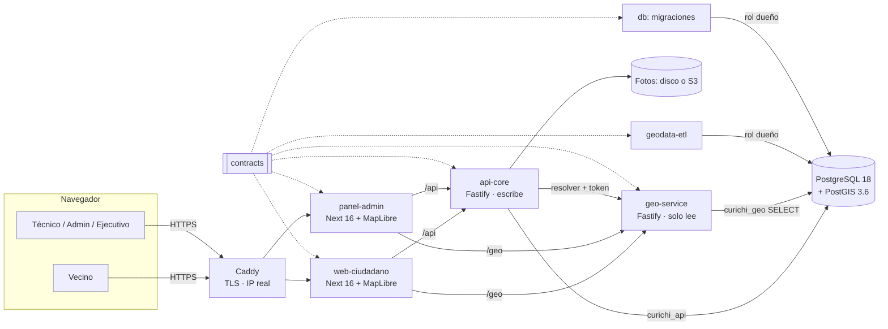

# Arquitectura de Mi Curichi — informes por parte

> Informes técnicos de **cómo funciona cada parte** del proyecto, escritos el **2026-10-06** leyendo el
> código de `main` en el commit `3121a0f` (contracts 0.18.0, migración 0019) y levantando el proyecto
> en local.
>
> Sirven para la **prueba de escalado** y para decidir si Mi Curichi sirve de **base para otros
> sistemas**. Complementan, sin reemplazarlos:
>
> - [`CLAUDE.md`](../../CLAUDE.md): reglas, alcance y proceso;
> - [`PROJECT_STRUCTURE_AND_FUNCTIONALITY.md`](../../PROJECT_STRUCTURE_AND_FUNCTIONALITY.md): vista general;
> - `docs/TRASPASO.md`, `docs/operaciones/` y `docs/seguridad/`.

## Leyenda (todos los informes)

| Marca | Significa |
|---|---|
| **[C]** | Confirmado leyendo el código o ejecutándolo |
| **[M]** | Medido (cifras de la Fase 4 en `docs/TRASPASO.md` §9 y `docs/operaciones/produccion.md`) |
| **[I]** | Inferido: parece así, pero no se comprobó de punta a punta |
| **[Doc]** | Según otro documento del repo, sin volver a comprobarlo |
| **[R]** | Recomendación, **no implementada** |

Las «Observaciones» de cada informe son pendientes **no corregidos**.

## Índice

| # | Informe | Parte | Para qué leerlo |
|---|---|---|---|
| 00 | [Puesta en marcha y prueba manual](00-puesta-en-marcha-y-prueba-manual.md) | — | Qué está levantado, cómo volver a levantarlo y la lista de prueba manual |
| 01 | [`packages/contracts`](01-contracts.md) | Transversal | Las reglas del dominio y la forma de cada mensaje |
| 02 | [`packages/db`](02-db.md) | 4 | Esquema, migraciones, roles, contraseñas, puntos críticos, seeds |
| 03 | [`services/geo-service`](03-geo-service.md) | 4 | PIP, capas con huella, teselas, cifras públicas |
| 04 | [`services/api-core`](04-api-core.md) | 3 | Reportes, visibilidad, moderación, fotos, auth, exportación |
| 05 | [`apps/web-ciudadano`](05-web-ciudadano.md) | 1 | Mapa público y flujo de reporte |
| 06 | [`apps/panel-admin`](06-panel-admin.md) | 2 | Bandeja, moderación, indicadores, ejecutivo, capas |
| 07 | [`pipelines/geodata-etl`](07-geodata-etl.md) | 5 | Shapefile → GeoJSON → PostGIS |
| 08 | [Infraestructura y DevOps](08-infraestructura-y-devops.md) | 5 | Compose, imágenes, Caddy, CI, observabilidad, respaldos, lanzador |
| 09 | [Calidad y pruebas](09-calidad-y-pruebas.md) | 5 | Pirámide de pruebas, E2E, huecos de cobertura |
| 10 | [Flujos de punta a punta](10-flujos-de-punta-a-punta.md) | Todas | Diagramas de secuencia de cada acción importante |
| 11 | [Escalado y ecosistema](11-escalado-y-ecosistema.md) | Todas | Cuello de botella, prueba de escalado y cómo reutilizarlo |
| **12** | [**Evaluación arquitectónica y de escalabilidad**](12-evaluacion-arquitectonica-y-escalabilidad.md) | Todas | **Informe principal de la FASE 2 (2026-10-07)**: versión exacta, acoplamiento, reutilización, multi-categoría, mediciones nuevas, estrategias y roadmap |
| **13** | [**Planificación de la plataforma multitemática**](13-planificacion-plataforma-multitematica.md) | Todas | **Informe principal de la FASE 3 (2026-10-07)**: Inundaciones, Baches, Áreas verdes y Basura sobre un mismo núcleo. Solo planificación |
| 13.1 | [Análisis del HTML, UX, iconografía y paleta](13.1-analisis-html-y-ux.md) | 1, 2 | El prototipo: qué adoptar y qué no; selector del mapa; colores medidos (contraste y daltonismo) |
| 13.2 | [Núcleo, categorías y modelo de datos](13.2-modelo-core-y-categorias.md) | Todas | Núcleo frente a módulo; opciones A–D; `DefinicionCategoria`; flujos; API; estructura |
| 13.3 | [Migración, pruebas, criterios, riesgos y ADR](13.3-plan-migracion.md) | Todas | Roadmap M0–M11; migración de datos; no contaminación; ADR 0008–0016 |
| **14** | [**Decisiones de M0 y plan de M1**](14-decisiones-m0-y-plan-m1.md) | Todas | **Respuestas del usuario (2026-10-07)**: alcance ampliado, categoría inicial por dispositivo, reinicio de filtros, cupo por categoría, «persona en situación de calle», áreas verdes con `Point`; roadmap y planes M0 y M1. **Manda sobre 13** donde difiera |
| 14.1 | [ADR propuestas 0008–0022](14.1-adr-propuestos.md) | Todas | Propuestas, con la marca de cuáles requieren aprobación explícita |

**Orden sugerido**: 14 (decisiones vigentes) → 14.1 → 13 (plan) → 12 (conclusiones) → 00 → 10 → 01 → 04 → 03 → 02 → 05 → 06 → 07 → 08 → 09 → 11.

> Los informes 00–11 son del 2026-10-06. Donde el 12 los contradice (por mediciones nuevas), manda
> el 12; los anteriores tienen una nota fechada en el lugar afectado.

## El sistema en una imagen

En `pnpm dev` no hay Caddy: el navegador habla directo con las apps en `localhost:3000` y `:3100`.

## Cinco ideas que explican casi todo

1. **El contrato manda.** `packages/contracts` define valores, reglas y mensajes. Si cambia, los
   consumidores no compilan.
2. **La base es la autoridad.** Visibilidad (`publicar_en`), cupos, sesiones, idempotencia y freno de
   login viven en tablas. Por eso escala con réplicas, salvo el rate limit por IP, que está en memoria.
3. **Lo público y lo técnico son rutas distintas.** Cambian la geometría (`geom_publico` con jitter
   frente a `geom` exacta), la URL y la caché. La ruta pública **no mira la sesión**.
4. **Mínimo privilegio en todas partes.** Hay tres roles de PostgreSQL; geo-service no puede escribir;
   en producción los servicios no arrancan con secretos de ejemplo ni con un rol privilegiado.
5. **Publicar no es un proceso: es un filtro.** `publicar_en <= now()` en una sola condición
   compartida por todas las rutas.
